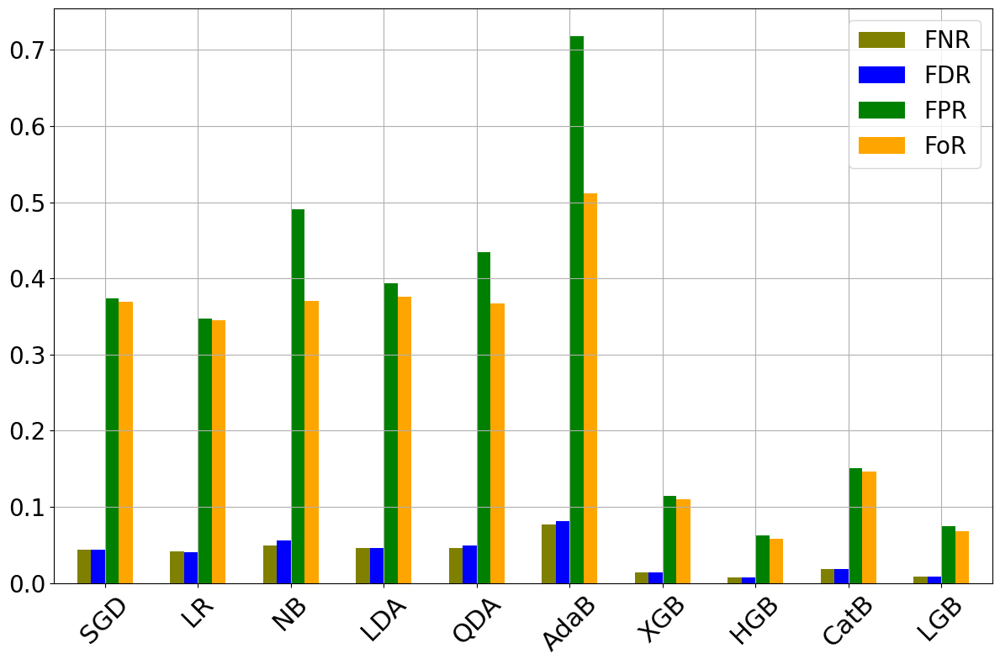
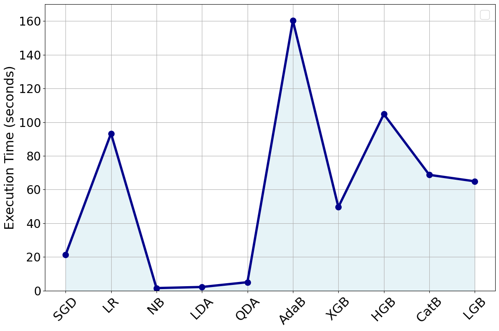
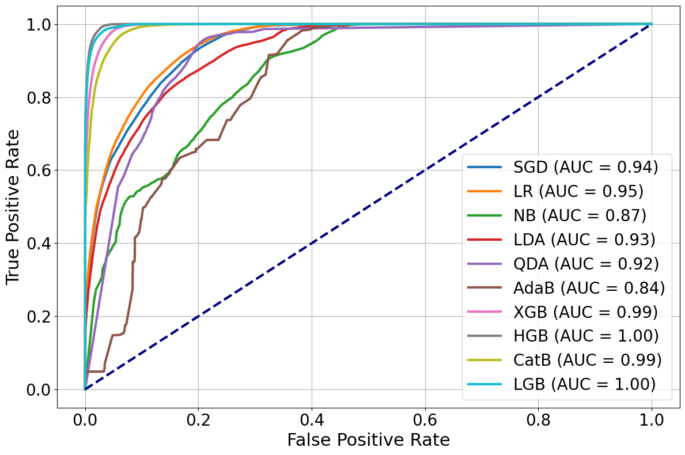
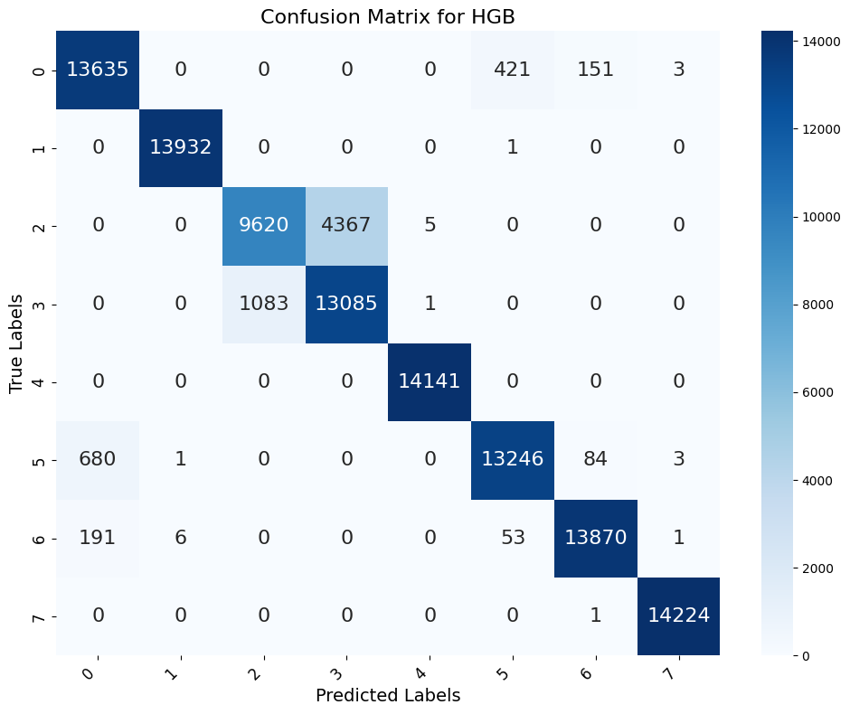

# Histogram Gradient Boosting for Attack Detection in IoT Networks

Code for the paper:

M. Nouman, N. Cordeschi and A. Fascista, "Machine Learning-Based Histogram Boosting Approach for Attack Detection in IoT Networks," *16th IFIP Wireless and Mobile Networking Conference (WMNC)*, Leuven, Belgium, 2025, pp. 53–57. [doi:10.23919/WMNC67099.2025.11299281](https://doi.org/10.23919/WMNC67099.2025.11299281)

Department of Electrical and Information Engineering (DEI), Politecnico di Bari, and CNIT, Italy.

## Overview

The paper proposes a three-phase framework for multi-class attack detection on the CICIoT2023 dataset:

1. **Preprocessing and attack mapping.** Missing and infinite values are replaced with column means, features are label-encoded and standardised, and the 33 attack classes are grouped into 7 categories based on shared features: DDoS, DoS, Mirai, Brute Force, Spoofing, Recon and Web-based (plus Benign).
2. **Class balancing.** ADASYN oversampling followed by random undersampling (RUS) gives 47,002 samples per class.
3. **Classification.** A Histogram Gradient Boosting (HGB) model is trained and compared with nine other models: SGD, Logistic Regression, Naive Bayes, LDA, QDA, AdaBoost, XGBoost, CatBoost and LightGBM.

All code is in [`HGB_IoT_Attack_Detection.ipynb`](HGB_IoT_Attack_Detection.ipynb). The notebook keeps the outputs of the run used for the paper.

## Dataset

[CICIoT2023](https://www.unb.ca/cic/datasets/iotdataset-2023.html) from the Canadian Institute for Cybersecurity, University of New Brunswick. It contains traffic from 105 IoT devices with 33 attack types. The experiments use the file `Merged52.csv`.

The dataset is not included in this repository. Download it and place `Merged52.csv` in a `data/` folder.

Mapping of the original labels to the 7 attack categories:

| Category | Original labels |
|---|---|
| DDoS | all `DDOS-*` labels |
| DoS | all `DOS-*` labels |
| Mirai | all `MIRAI-*` labels |
| Recon | `RECON-*`, `VULNERABILITYSCAN` |
| Spoofing | `MITM-ARPSPOOFING`, `DNS_SPOOFING` |
| Web-based | SQL injection, command injection, backdoor malware, uploading attack, XSS, browser hijacking |
| Brute Force | dictionary brute force |
| Benign | `BENIGN` |

## Results

### Class distribution before and after resampling (Table I)

| Class | Original | After ADASYN | After RUS |
|---|---:|---:|---:|
| DDoS | 47,729 | 47,729 | 47,002 |
| DoS | 11,120 | 47,002 | 47,002 |
| Mirai | 3,664 | 47,724 | 47,002 |
| Benign | 1,471 | 47,733 | 47,002 |
| Recon | 981 | 47,857 | 47,002 |
| Spoofing | 715 | 47,706 | 47,002 |
| Web-based | 25 | 47,724 | 47,002 |
| Brute Force | 18 | 47,730 | 47,002 |

### Model comparison on CICIoT2023 (Table II)

70% of the balanced data is used for training and 30% for testing. Precision, recall and F1 are weighted averages.

| Model | Accuracy | Precision | Recall | F1 Score |
|---|---:|---:|---:|---:|
| SGD | 0.6264 | 0.6304 | 0.6264 | 0.6157 |
| LR | 0.6529 | 0.6551 | 0.6529 | 0.6445 |
| NB | 0.5098 | 0.6286 | 0.5098 | 0.4389 |
| LDA | 0.6069 | 0.6231 | 0.6069 | 0.6006 |
| QDA | 0.5652 | 0.6322 | 0.5652 | 0.5150 |
| AdaBoost | 0.2815 | 0.4878 | 0.2815 | 0.2364 |
| XGBoost | 0.8859 | 0.8901 | 0.8859 | 0.8848 |
| **HGB** | **0.9375** | **0.9419** | **0.9375** | **0.9368** |
| CatBoost | 0.8496 | 0.8539 | 0.8496 | 0.8470 |
| LightGBM | 0.9259 | 0.9315 | 0.9259 | 0.9253 |

HGB gives the best results on all four metrics, followed by LightGBM and XGBoost. The notebook also reports MCC (0.9295 for HGB) and multi-class AUC (0.9955 for HGB). Both tables are also available as CSV files in [`results/`](results/).

### Error metrics (Fig. 2)

FNR, FDR, FPR and FoR averaged over the classes. HGB and LightGBM have the lowest error rates, while AdaBoost has the highest.



### Execution time (Fig. 3)



### Other figures from the notebook

| ROC curves | Confusion matrix (HGB) |
|---|---|
|  |  |

In the confusion matrix the classes are numbered alphabetically: 0 Benign, 1 Brute Force, 2 DDoS, 3 DoS, 4 Mirai, 5 Recon, 6 Spoofing, 7 Web-based. Most remaining errors are between DDoS and DoS, which have similar traffic patterns.

## Running the code

```bash
git clone https://github.com/Muhammad-Nouman-s/HGB-IoT-Attack-Detection.git
cd HGB-IoT-Attack-Detection
pip install -r requirements.txt
jupyter notebook HGB_IoT_Attack_Detection.ipynb
```

Notes:

- The experiments were run on Google Colab. The notebook is tested with scikit-learn 1.6.1. Newer scikit-learn versions raise an error in QDA when a class covariance matrix is not full rank (which happens for the very small Brute Force class), so keep the pinned version.
- Resampling is applied to the full dataset before the 70/30 split, as described in the paper.
- The outputs saved in the notebook come from the same run as the paper. Logistic Regression shows a small difference in the fourth decimal (0.6525 vs 0.6529), and execution times vary between runs. The execution time figure uses the values reported in the paper.

## Repository structure

```
.
├── HGB_IoT_Attack_Detection.ipynb   # full pipeline: preprocessing, resampling, models, figures
├── figures/                         # figures exported from the notebook
├── results/                         # Table I and Table II of the paper as CSV
├── requirements.txt
└── LICENSE
```

## Citation

```bibtex
@inproceedings{nouman2025hgb,
  author    = {Nouman, Muhammad and Cordeschi, Nicola and Fascista, Alessio},
  title     = {Machine Learning-Based Histogram Boosting Approach for Attack Detection in {IoT} Networks},
  booktitle = {2025 16th IFIP Wireless and Mobile Networking Conference (WMNC)},
  address   = {Leuven, Belgium},
  pages     = {53--57},
  year      = {2025},
  doi       = {10.23919/WMNC67099.2025.11299281}
}
```

## Contact

Muhammad Nouman, Politecnico di Bari: m.nouman@phd.poliba.it
[Website](https://muhammad-nouman-s.github.io/) | [Google Scholar](https://scholar.google.com/citations?user=ebfBz34AAAAJ)

The code is released under the [MIT License](LICENSE). The CICIoT2023 dataset is subject to its own terms of use.
